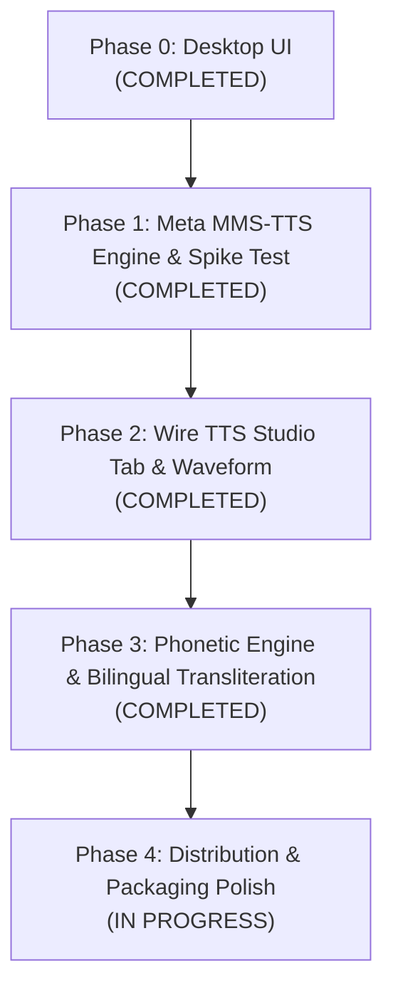

# KhmerTTS Implementation Plan

An offline Windows & Linux desktop application for Khmer and English Text-to-Speech synthesis with voice styling and waveform visualization, built strictly in compliance with [AGENT.md](file:///media/spiderweb/DATA/Niseth_E5/AGENT.md) and [PLAN.md](file:///media/spiderweb/DATA/Niseth_E5/PLAN.md).

---

## 1. Architectural & Engineering Decisions

| Area | Decision | Details & Constraints |
| :--- | :--- | :--- |
| **Project Focus** | **Text-to-Speech Studio** | Focus exclusively on high-quality, offline Text-to-Speech. Video dubbing pipelines and OmniVoice have been removed to keep the application ultra-lightweight and fast. |
| **TTS Engine** | **Meta MMS-TTS Khmer (`facebook/mms-tts-khm`)** | VITS-based neural TTS (~139 MB). Runs at ~0.3s latency on CPU with < 1 GB peak RAM. |
| **Bilingual Support** | **Khmer Phonetic Transliteration Engine** | Automatic transliteration of English loanwords, acronyms, and conversational phrases into phonetic Khmer script so MMS-TTS speaks both languages smoothly. |
| **Voice Styling** | **Character Presets & Pitch/Tempo Shaping** | Offers Female, Male, Deep Male, Storyteller, and News Anchor presets using bundled ffmpeg pitch and tempo filters. |
| **Compute & Runtime** | **CPU-First (Intel i7-8750H)** | Lightweight PyTorch CPU packages eliminate CUDA driver hurdles and conserve RAM. Optional GPU mode available via settings. |
| **Project Isolation** | **100% Self-Contained** | All models download exclusively to `models/` with `HF_HOME` locked before any imports. Environment in `venv/`, tools in `tools/ffmpeg/`, temporary files in `temp/`, exports in `exports/`. |

---

## 2. System Architecture & Component Layout

```
khmer_tts/
├── app.py                       # Application entry point (HF_HOME set at very top)
├── run.sh                       # Self-contained launcher script
├── requirements.txt             # Pinned project dependencies
├── LICENSES.md                  # Comprehensive third-party license registry
├── implementation_plan.md       # Master project roadmap
├── assets/                      # Icons, UI SVGs, and reference audio clips
│   ├── down_arrow.svg
│   ├── checkbox_checked.svg
│   └── phanith_speaker.wav
├── ui/                          # Presentation layer (Pure PySide6, no ML logic)
│   ├── styles.py                # Emerald design tokens & QSS styles
│   ├── components.py            # WaveformWidget, SegmentedTab, StatusBadge
│   ├── main_window.py           # Top navigation bar, status indicator, stacked layout
│   ├── tts_tab.py               # Standalone TTS interface & waveform player
│   └── settings_tab.py          # Engine status, performance toggles, storage cleanup
├── core/                        # Logic layer (No UI dependencies)
│   ├── config.py                # App configuration & path management
│   ├── controller.py            # Background QThread worker & history persistence
│   ├── tts_engine.py            # Meta MMS-TTS synthesis, audio export & memory cleanup
│   ├── khmer_phonetics.py       # English-to-Khmer phonetic transliteration engine
│   └── spike_test.py            # Standalone benchmarking script
├── models/                      # Downloaded model weights (HF_HOME cache, ~139 MB)
├── tools/ffmpeg/                # Bundled ffmpeg binaries
├── temp/                        # Intermediate processing files (wiped on cleanup)
└── exports/                     # Rendered audio files (.wav, .mp3)
```

---

## 3. Phased Implementation Roadmap



---

### Phase 0: Desktop UI (Completed)
- [x] Implemented emerald design system (`#0F6B58`, `#E0F2EE`) in [`ui/styles.py`](file:///media/spiderweb/DATA/Niseth_E5/ui/styles.py).
- [x] Built custom widgets in [`ui/components.py`](file:///media/spiderweb/DATA/Niseth_E5/ui/components.py) (status pills, interactive waveform player).
- [x] Built main presentation screens:
  - [`ui/tts_tab.py`](file:///media/spiderweb/DATA/Niseth_E5/ui/tts_tab.py): Text editor with character counter, voice styling presets, waveform player, recent history.
  - [`ui/settings_tab.py`](file:///media/spiderweb/DATA/Niseth_E5/ui/settings_tab.py): Hardware toggles, performance modes, cache cleanup.
- [x] Created top header bar and tab switcher in [`ui/main_window.py`](file:///media/spiderweb/DATA/Niseth_E5/ui/main_window.py).
- [x] Built launcher script [`run.sh`](file:///media/spiderweb/DATA/Niseth_E5/run.sh) and verified native GUI execution on `:0`.

---

### Phase 1: Meta MMS-TTS Engine & Spike Benchmark (Completed)
- [x] Removed OmniVoice and purged heavy model blobs (~4.6 GB freed).
- [x] Verified local snapshot loading for Meta MMS-TTS Khmer (`facebook/mms-tts-khm`) in `models/` with `HF_HUB_OFFLINE=1` and `TRANSFORMERS_OFFLINE=1`.
- [x] Executed spike benchmark on CPU:
  - Khmer text generation: ~0.3s latency, 711.9 MB peak RAM.
  - English text generation via phonetics: < 1.0s latency.

---

### Phase 2: TTS Studio & Waveform Integration (Completed)
- [x] **Core Configuration & Offline Environment ([`core/config.py`](file:///media/spiderweb/DATA/Niseth_E5/core/config.py))**:
  - Enforced `HF_HOME`, `HF_HUB_OFFLINE=1`, and `TRANSFORMERS_OFFLINE=1`.
  - Pinned bundled ffmpeg to system PATH.
- [x] **TTS Engine Wrapper ([`core/tts_engine.py`](file:///media/spiderweb/DATA/Niseth_E5/core/tts_engine.py))**:
  - Native synthesis via Meta MMS-TTS Khmer.
  - Character presets (Female, Male, Deep Male, Storyteller, News Anchor).
  - Voice cloning pitch matching with reference audio.
  - Generates normalized 40-bar audio waveform data.
  - Audio export to `.wav` and `.mp3` via bundled ffmpeg.
  - Single-model residency and low-memory cleanup (`del`, `gc.collect()`).
- [x] **Background Worker & History Persistence ([`core/controller.py`](file:///media/spiderweb/DATA/Niseth_E5/core/controller.py))**:
  - `TTSWorkerThread` (`QThread`) prevents UI freezes during synthesis.
  - Persists recent generations to `temp/recent_tts.json` with click-to-replay.
- [x] **Interactive Waveform Player ([`ui/components.py`](file:///media/spiderweb/DATA/Niseth_E5/ui/components.py))**:
  - Dynamic playback progress, seek-on-click, timestamp counters.
- [x] Verified with 13/13 passing tests in [`tests/test_phase2.py`](file:///media/spiderweb/DATA/Niseth_E5/tests/test_phase2.py).

---

### Phase 3: Phonetic Engine & Bilingual Transliteration (Completed)
- [x] Built comprehensive English-to-Khmer phonetic transliteration dictionary and rule engine in [`core/khmer_phonetics.py`](file:///media/spiderweb/DATA/Niseth_E5/core/khmer_phonetics.py).
- [x] Normalizes Khmer keyboard typos and Limon legacy encoding.
- [x] Transliterates English loanwords, acronyms, and conversational phrases into phonetic Khmer so MMS-TTS speaks both languages smoothly without skipping words.

---

### Phase 4: Distribution & Packaging Polish (Current Phase)
- [ ] PyInstaller packaging specification for single-folder standalone distribution.
- [ ] Memory limit validation on 8 GB RAM machines.
- [ ] Complete offline verification check.
