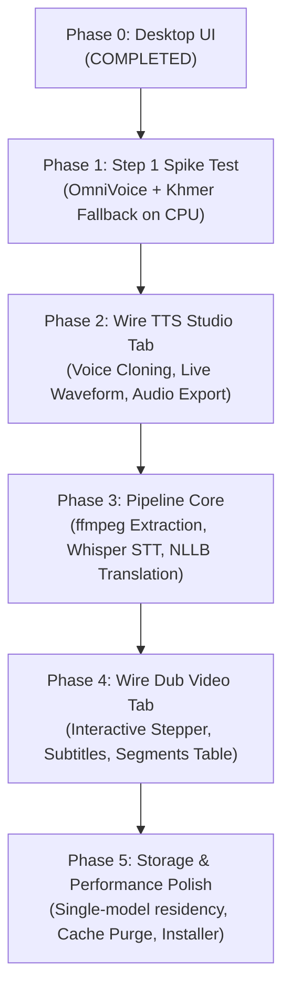

# KhmerDub Implementation Plan

An offline Windows & Linux desktop application for English and Khmer video dubbing and text-to-speech with voice cloning, built strictly in compliance with [AGENT.md](file:///media/spiderweb/DATA/Niseth_E5/AGENT.md) and [PLAN.md](file:///media/spiderweb/DATA/Niseth_E5/PLAN.md).

---

## 1. Architectural & Engineering Decisions (Aligned via Grill-Me)

| Area | Decision | Details & Constraints |
| :--- | :--- | :--- |
| **Compute & Runtime** | **CPU-First (Intel i7-8750H)** | Run on CPU using multi-threading and FP32/INT8 precision. Lightweight PyTorch CPU packages eliminate CUDA driver communication hurdles on Linux and conserve RAM. GPU (GTX 1050 2 GB) acceleration will be benchmarked later. |
| **Licensing Scope** | **Personal & Non-Commercial** | Non-commercial dubbing scope confirmed. Uses `facebook/nllb-200-distilled-600M` (`khm_Khmr` ⇄ `eng_Latn`) under CC-BY-NC-4.0. |
| **Voice Cloning Reference** | **Bundled Reference + Custom Upload** | Bundled `assets/sample_speaker.wav` for automated test suites; file chooser in the UI for user voice clips. |
| **TTS Risk Mitigation** | **Meta MMS-TTS Khmer Fallback** | If OmniVoice (`k2-fsa/OmniVoice`) proves unintelligible for Khmer, seamlessly fallback to Meta's open-source `facebook/mms-tts-khm`. |
| **Project Isolation** | **100% Self-Contained** | All models download exclusively to `models/` with `HF_HOME` pinned before any imports. Environment in `venv/`, tools in `tools/ffmpeg/`, temporary work files in `temp/`, exports in `exports/`. |

---

## 2. System Architecture & Component Layout

```
khmerdub/
├── app.py                       # Application entry point (HF_HOME set at very top)
├── run.sh                       # Self-contained launcher script
├── requirements.txt             # Pinned project dependencies
├── LICENSES.md                  # Comprehensive third-party license registry
├── implementation_plan.md       # Master project roadmap
├── assets/                      # Icons, UI SVGs, and bundled reference clips
│   ├── down_arrow.svg
│   ├── checkbox_checked.svg
│   └── sample_speaker.wav
├── ui/                          # Presentation layer (Pure PySide6, no ML logic)
│   ├── styles.py                # Emerald design tokens & QSS styles
│   ├── components.py            # Stepper, StatusBadge, WaveformWidget, SegmentedTab
│   ├── main_window.py           # Top navigation bar, status indicator, stacked layout
│   ├── dub_tab.py               # Video dubbing pipeline UI & editable segments table
│   ├── tts_tab.py               # Standalone TTS interface & waveform player
│   └── settings_tab.py          # Engine status, performance toggles, storage cleanup
├── core/                        # Logic & Pipeline layer (No UI dependencies)
│   ├── config.py                # App configuration & path management
│   ├── controller.py            # Background QThread worker & pipeline event emitter
│   ├── audio_tools.py           # ffmpeg audio extraction, tempo adjustment, mixing
│   ├── stt.py                   # Speech-to-text (faster-whisper + Khmer Whisper)
│   ├── translate.py             # Machine translation (NLLB-200 600M)
│   ├── tts_engine.py            # OmniVoice / MMS-TTS synthesis & memory management
│   └── spike_test.py            # Standalone benchmarking script for Step 1
├── models/                      # Downloaded model weights (HF_HOME cache)
├── tools/ffmpeg/                # Bundled ffmpeg binaries
├── temp/                        # Intermediate processing files (wiped on cleanup)
└── exports/                     # Rendered videos, audio files, and .srt subtitles
```

---

## 3. Phased Implementation Roadmap



---

### Phase 0: Desktop UI (Completed)
- [x] Implemented emerald design system (`#0F6B58`, `#E0F2EE`) in [`ui/styles.py`](file:///media/spiderweb/DATA/Niseth_E5/ui/styles.py).
- [x] Built custom widgets in [`ui/components.py`](file:///media/spiderweb/DATA/Niseth_E5/ui/components.py) (5-step pipeline stepper, status pills, interactive waveform player).
- [x] Built all 3 main screens matching the mockup PDF:
  - [`ui/dub_tab.py`](file:///media/spiderweb/DATA/Niseth_E5/ui/dub_tab.py): Video preview with subtitle overlay, dubbing options, editable Khmer segments table.
  - [`ui/tts_tab.py`](file:///media/spiderweb/DATA/Niseth_E5/ui/tts_tab.py): Text editor with character counter, cloning controls, waveform result player, recent history.
  - [`ui/settings_tab.py`](file:///media/spiderweb/DATA/Niseth_E5/ui/settings_tab.py): Pipeline engine monitors, performance toggles, cache cleanup.
- [x] Created top header bar and tab switcher in [`ui/main_window.py`](file:///media/spiderweb/DATA/Niseth_E5/ui/main_window.py).
- [x] Built launcher script [`run.sh`](file:///media/spiderweb/DATA/Niseth_E5/run.sh) and verified native GUI execution on `:0`.

---

### Phase 1: Step 1 Spike Test (Current Phase)
*Objective: Prove OmniVoice speech quality, latency, and memory footprint on CPU for Khmer and English.*

1. **Environment Setup**:
   - Install CPU-optimized PyTorch (`torch`, `torchaudio`) and `omnivoice` (with `--no-cache-dir`).
   - Generate `assets/sample_speaker.wav` for reference cloning.
2. **Benchmark Script ([`core/spike_test.py`](file:///media/spiderweb/DATA/Niseth_E5/core/spike_test.py))**:
   - Enforce `HF_HOME=models/` at top of file.
   - Synthesize English test line: *"Hello, welcome to KhmerDub, an offline video dubbing studio."*
   - Synthesize Khmer test line: *"សួស្តី សូមស្វាគមន៍មកកាន់ KhmerDub ដែលជាកម្មវិធីបញ្ចូលសំឡេងវីដេអូ។"*
   - Record generation latency (seconds), real-time factor (RTF), and peak resident memory (RAM MB).
3. **Quality & Intelligibility Check**:
   - Verify generated `.wav` audio files in `temp/`.
   - If OmniVoice Khmer output is distorted or unvoiced, evaluate Meta's `facebook/mms-tts-khm` fallback.
4. **License & Reporting**:
   - Update [`LICENSES.md`](file:///media/spiderweb/DATA/Niseth_E5/LICENSES.md) with confirmed model licenses.
   - Present benchmark report to the owner.

---

### Phase 2: TTS Tab Integration
*Objective: Connect the standalone Text-to-Speech studio so users can generate and save audio.*

1. **TTS Engine Wrapper ([`core/tts_engine.py`](file:///media/spiderweb/DATA/Niseth_E5/core/tts_engine.py))**:
   - Manage model lifecycle: load on demand, generate with CPU/GPU device selection, free memory (`del`, `gc.collect()`).
   - Support both voice cloning (with reference audio) and default voices.
2. **UI Integration**:
   - Connect "Generate speech" button to background `QThread` worker.
   - Stream audio amplitudes to [`WaveformWidget`](file:///media/spiderweb/DATA/Niseth_E5/ui/components.py).
   - Wire "Save as .wav" and "Save as .mp3" actions.
   - Persist recent generations list.

---

### Phase 3: Pipeline Core (CLI Verification)
*Objective: Build and verify the end-to-end dubbing pipeline before wiring the UI.*

1. **Audio Tools ([`core/audio_tools.py`](file:///media/spiderweb/DATA/Niseth_E5/core/audio_tools.py))**:
   - Audio extraction from video: `ffmpeg -i input.mp4 -vn -acodec pcm_s16le -ar 16000 ...`
   - Tempo adjustment for line fitting (`atempo` filter).
   - Audio mixing: duck original background track and overlay generated dub.
2. **Speech-to-Text ([`core/stt.py`](file:///media/spiderweb/DATA/Niseth_E5/core/stt.py))**:
   - `faster-whisper` for English audio segmentation and timestamps.
   - Local Khmer Whisper checkpoint for Khmer audio.
3. **Translation ([`core/translate.py`](file:///media/spiderweb/DATA/Niseth_E5/core/translate.py))**:
   - `facebook/nllb-200-distilled-600M` for bidirectional English ⇄ Khmer translation.
4. **CLI Validation**:
   - Run end-to-end pipeline script on a sample 10-second video clip.

---

### Phase 4: Dub Video Tab Integration
*Objective: Connect the complete pipeline to the native UI with real-time feedback.*

1. **Pipeline Controller ([`core/controller.py`](file:///media/spiderweb/DATA/Niseth_E5/core/controller.py))**:
   - Orchestrates pipeline steps on background threads.
   - Emits signals: `step_changed(int)`, `segment_transcribed(dict)`, `segment_translated(dict)`, `segment_voiced(dict)`, `progress_updated(float)`.
2. **UI Wiring ([`ui/dub_tab.py`](file:///media/spiderweb/DATA/Niseth_E5/ui/dub_tab.py))**:
   - Pipeline stepper highlights active step (1 to 5).
   - Segments table populates dynamically with timestamps and editable Khmer text.
   - "Regenerate selected" triggers selective TTS regeneration for edited rows.
   - "Export dubbed video" and "Export subtitles (.srt)" save to `exports/`.

---

### Phase 5: Storage & Performance Polish
*Objective: Ensure robustness, strict resource limits, and clean distribution.*

1. **Single-Model Residency**:
   - Enforce strictly loading only one model at a time into RAM/VRAM.
   - Unload STT model before loading Translation; unload Translation before loading TTS.
2. **Storage Tools**:
   - "Clear temporary files" purges `temp/`.
   - "Delete downloaded models" removes weights from `models/` with user confirmation.
   - Dynamic disk size calculation for `models/`.
3. **Packaging**:
   - Standalone bundling configuration via PyInstaller.

